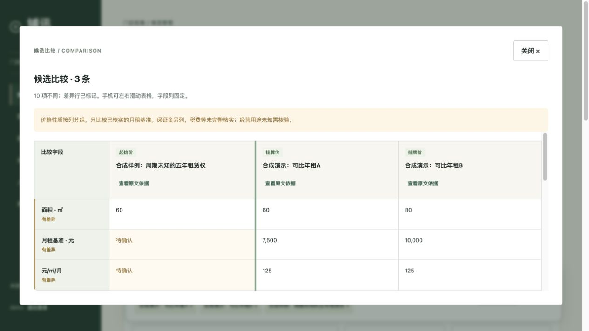
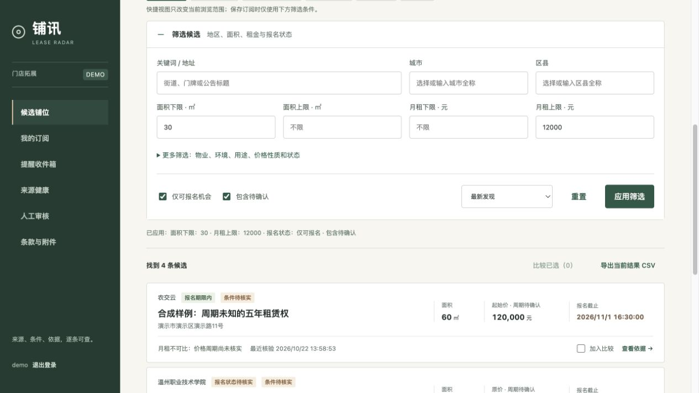
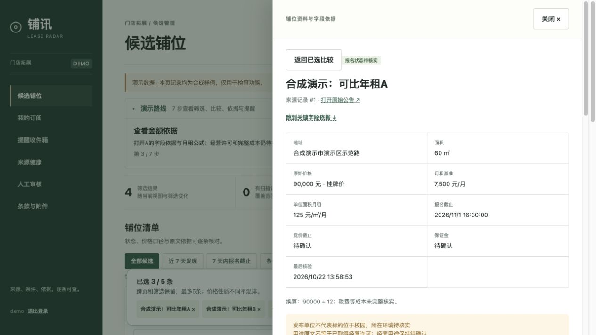
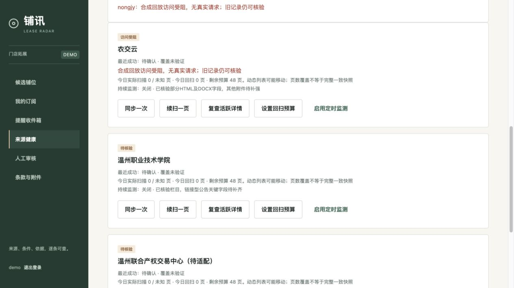
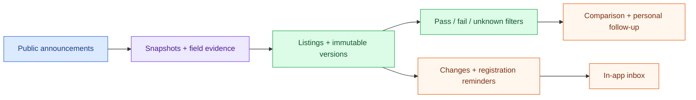
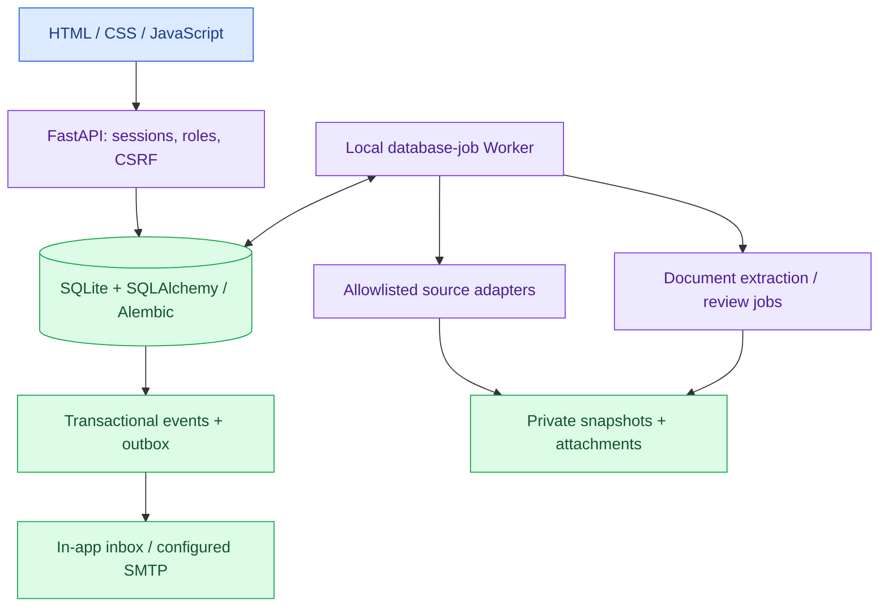

# LeaseRadar · 铺讯

**Discover leasing announcements, check the evidence, and keep expansion follow-ups in one workspace.**

**English** · [简体中文](README.zh-CN.md)

[](https://github.com/17-chen/LeaseRadar/actions/workflows/test.yml)


[](LICENSE)

[Quick start](#quick-start) · [Features](#features) · [Preview](#workspace-preview) · [Architecture](#architecture) · [Project status](#project-status) · [Documentation](#documentation-and-contributions)

Public leasing announcements are scattered across websites, and important terms often live in attachments. LeaseRadar brings discovery, configurable filters, comparable rent, field evidence, change notifications, and personal follow-ups into a traceable workflow for retail expansion teams.

**An unknown price period stays unknown. Every derived rent figure needs evidence.** A title that mentions five years does not establish that its price covers all five years; an announcement's stated use does not establish an operating permit.

> [!NOTE]
> This is a local development application, currently `0.1.16`, with a Chinese interface. The overview is available in English and Chinese. Production deployment, complete second-source coverage, real PDF/OCR accuracy, and external email delivery still need acceptance testing. The demo uses synthetic data and disables external collection, email, and downloads.

## Features

| Capability | What is implemented |
| --- | --- |
| Announcement monitoring | Source adapters, pagination/backfill, detail rechecks, immutable versions, private snapshots, and visible blocked/retry states |
| Flexible filtering | Keywords, location, area, verified monthly rent, property/use conditions, and registration status; pass/fail/unknown matching |
| Comparable rent | Compare 2–5 candidates by price type; retain original amounts, calculation evidence, deposits, and unknown periods separately |
| Field evidence | Inspect original text and attachments; distinguish source changes, extraction updates, manual corrections, and conflicts |
| Personal workspace | Favorites, follow-up stages, private notes, account isolation, and export of all results matching the applied filters |
| Notifications | In-app changes and registration reminders; configurable SMTP, summaries, delivery receipts, and review of uncertain sends |
| Document review | Controlled PDF/DOCX downloads and private extraction/review jobs; DOCX body/table positions and validated PDF/OCR output |
| Durable operation | Database jobs, leases, recovery, transactional events/outbox, coverage budgets, and backup utilities |

These are implemented capabilities. Real-source validation and production limits are described in [project status](#project-status).

## Workspace preview

The actual application running with **synthetic demo data**: two verified monthly rent bases beside a candidate whose price period remains unknown. The interface is currently Chinese.



<details>
<summary>More demo screens: filters, evidence, and source health</summary>

### Apply your own filters



### Inspect the basis for a field



### Keep blocked sources visible



</details>

A [207.6-second narrated browser walkthrough](output/video/LeaseRadar_Full_Browser_Review_20261028.mp4) and a [six-page introduction PDF](output/pdf/LeaseRadar_Competition_Intro_Draft.pdf) are available in the repository. The recording uses automated browser actions and system narration over synthetic data; it is a review draft, not real-user trial evidence. See the [materials index (中文)](docs/submission/README.md) for captions and dated verification.

## From announcement to follow-up



Amounts use `Decimal`; explicit timestamps carry time zones. Registration deadlines take precedence over bidding deadlines. Events and outbox records are committed together with unique identities; external email delivery is tracked separately and is not promised to be exactly once.

## Architecture



The verified local path uses SQLite and a persistent database queue. PostgreSQL, Redis, Celery, and an isolated extraction worker are supplied as deployment configurations; their production operation is not yet accepted. Extraction results require validation and human review before changing business fields. The application uses deterministic extraction and rules, with no LLM dependency.

## Quick start

### 1. Try the isolated synthetic demo

Requires **Git and Python 3.12 or 3.13**. From a fresh clone on macOS/Linux:

```bash
git clone https://github.com/17-chen/LeaseRadar.git
cd LeaseRadar
python3 -m venv .venv
.venv/bin/pip install -r backend/requirements.lock
.venv/bin/python scripts/demo.py --port 8002
```

Open `http://127.0.0.1:8002/`. The terminal prints the path to a newly generated private `DEMO_GUIDE.md`, containing the local account and walkthrough. Each run creates a fresh directory under `private/demo-runs/`; existing databases are preserved. On Windows, use `.venv\Scripts\python.exe` and `.venv\Scripts\pip.exe` for the corresponding commands.

Click **开始演示** to follow the seven-step route: filters → comparison → known-price evidence → unknown period → inbox → follow-up → blocked source. The fixture contains **6 candidates, 7 versions, and 5 in-app notices**. Favorites and filtered CSV export are also available.

Stop with `Ctrl-C`. If the port is occupied, choose another unused port. If an old demo's deadlines have expired, create a new demo rather than changing its timestamps or treating it as current data.

### 2. Run a personal local workspace

From an installed checkout, apply migrations and create a local administrator:

```bash
PYTHONPATH=backend .venv/bin/python -m app.cli migrate
PYTHONPATH=backend .venv/bin/python -m app.cli create-admin
PYTHONPATH=backend .venv/bin/uvicorn app.main:app --host 127.0.0.1 --port 8000
```

Start the job Worker in another terminal from the project root:

```bash
PYTHONPATH=backend .venv/bin/python -m app.local_worker
```

Open `http://127.0.0.1:8000/`. Sources are disabled by default. Monitoring depends on the Worker and host staying awake; closing the terminal or shutting down the machine interrupts processing. Private runtime settings, authorized email recipients, attachment workers, backups, and deployment configuration are documented in the [deployment guide (中文)](docs/DEPLOYMENT.md) and [configuration checklist (中文)](docs/FINAL_SETUP_CHECKLIST.md).

### 3. Review the recorded walkthrough

```bash
python3 scripts/serve_video_review.py --port 8017
```

Open `http://127.0.0.1:8017/` for the narrated video, Chinese captions, and ten scene-jump controls. This loopback-only server supports byte ranges for seeking. Caption text matches the narration script, while timing within each scene is estimated; full human listening review is still pending. See the [caption review record (中文)](docs/submission/CAPTION_REVIEW_20261029.md).

## Project status

Evidence snapshot: **2026-11-01**. Test counts describe engineering checks, not field accuracy or business results.

| Area | Evidence and remaining work |
| --- | --- |
| Automated checks | [CI for `5e19d0b`](https://github.com/17-chen/LeaseRadar/actions/runs/41220130408) passed 327 application tests and 1 Poppler integration test; it also checks migrations and frontend JavaScript syntax. These are recorded results, not tests rerun for this README edit. |
| Real sources | Historical validation covered 24 Nongjiyun listings and 1 university link-only record, with 6 DOCX rent-period checks. The university adapter has a historical full-text sample, but complete second-source field coverage remains unfinished. See the [source audit (中文)](docs/SOURCE_AUDIT.md). |
| Recovery and demo | Isolated synthetic workflows, account/session boundaries, SQLite migration/backup recovery, and exact review-ZIP restoration have dated records in the [handoff (中文)](PROJECT_HANDOFF.md) and [materials index (中文)](docs/submission/README.md). |
| Documents and email | DOCX and controlled extraction paths have implementation and local checks. Real PDF/OCR accuracy, container isolation acceptance, and real provider delivery remain unverified. |
| Production | Docker configurations exist; public application hosting, production concurrency, PostgreSQL recovery, sustained source coverage, and real-user trials are not accepted. |

The repository is public. An application hosting URL, public video-sharing link, and formal contest submission receipt have not been verified in project records. Historical materials retain their original dates and may describe earlier repository visibility.

## Development and checks

Run from the project root after installing the locked dependencies:

```bash
PYTHONPATH=backend .venv/bin/python -m pytest -q backend/tests
node --check frontend/app.js
node --check output/video/review.js
.venv/bin/python scripts/build_browser_captions.py --check
.venv/bin/python -m pip check
git diff --check
```

Poppler integration checks run separately when `pdftotext` and `pdfinfo` are on `PATH`:

```bash
PYTHONPATH=backend .venv/bin/python -m pytest -q backend/integration/test_document_tools.py
```

Tests use isolated databases and synthetic/local notification endpoints. Media rebuilding has additional optional tooling: the current narrated-video renderer uses macOS speech tools and Swift/AVFoundation. See the [contributing guide](CONTRIBUTING.md) before changing domain rules or source adapters.

## Repository map

| Path | Purpose |
| --- | --- |
| [`frontend/`](frontend/) | Chinese workspace UI, evidence panels, comparison, and account interactions |
| [`backend/app/`](backend/app/) | API, domain rules, source adapters, jobs, notifications, and document review |
| [`backend/migrations/`](backend/migrations/) | Alembic schema migrations |
| [`backend/tests/`](backend/tests/) · [`backend/integration/`](backend/integration/) | Isolated regressions and real-tool integration checks |
| [`fixtures/`](fixtures/) | Synthetic replay, adapter, and evaluation samples |
| [`scripts/`](scripts/) | Fresh demo setup, media review, and archive verification utilities |
| [`docs/`](docs/) · [`output/`](output/) | Architecture, dated evidence, synthetic screenshots, and review artifacts |
| `private/` | Local accounts, databases, snapshots, attachments, and backups; excluded from Git |

## Documentation and contributions

- [中文首页](README.zh-CN.md)
- [Architecture (中文)](ARCHITECTURE.md) · [Deployment (中文)](docs/DEPLOYMENT.md)
- [Demo guide (中文)](docs/COMPETITION_DEMO.md) · [Introduction and video materials (中文)](docs/submission/README.md)
- [Roadmap (中文)](ROADMAP.md) · [Open tasks (中文)](TODO.md) · [Changelog (中文)](CHANGELOG.md)
- [Project context (中文)](PROJECT_CONTEXT.md) · [Detailed handoff (中文)](PROJECT_HANDOFF.md)
- [Contributing](CONTRIBUTING.md) · [Code of conduct](CODE_OF_CONDUCT.md) · [Security](SECURITY.md)
- [Previous README and stage notes (中文)](docs/archive/README.before-bilingual.zh-CN.md)

Bug reports and documentation improvements in either language are welcome. Include reproduction steps and distinguish synthetic, replayed, and live inputs. Remove credentials, original private documents, and personal notes before sharing logs or screenshots.

## License

Original project code is available under the [MIT License](LICENSE). Source announcements, attachments, trademarks, and original handoff materials have their own rights; see the [data policy (中文)](docs/DATA_POLICY.md) and [dependency license notes (中文)](docs/DEPENDENCY_LICENSES.md).
