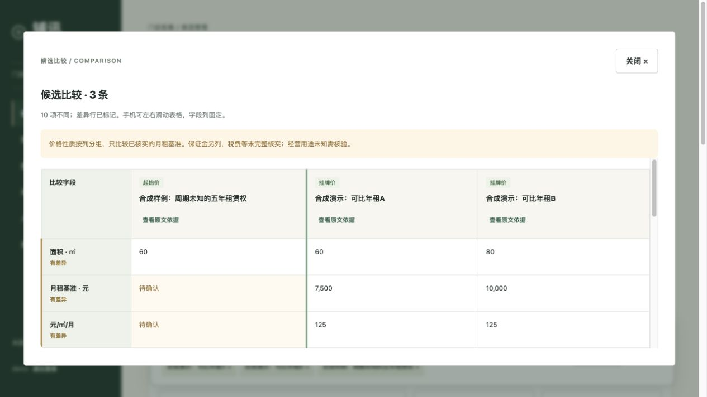
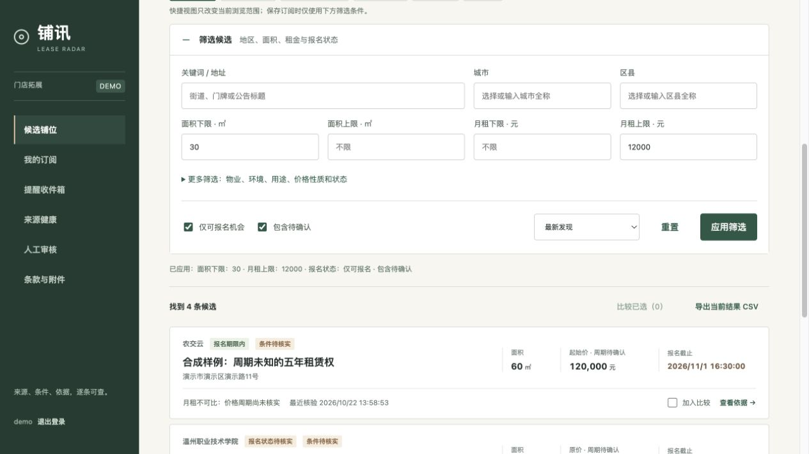
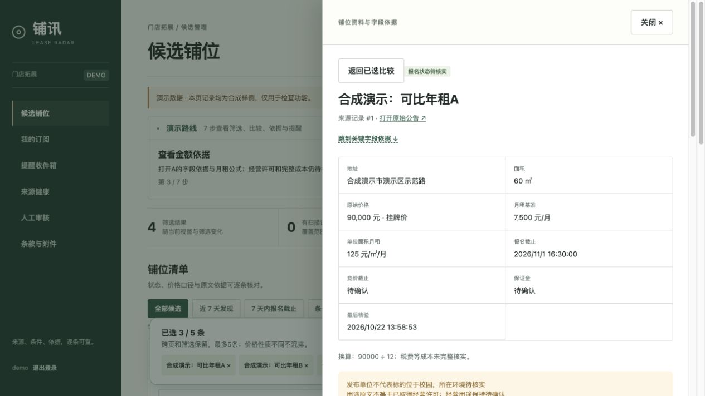
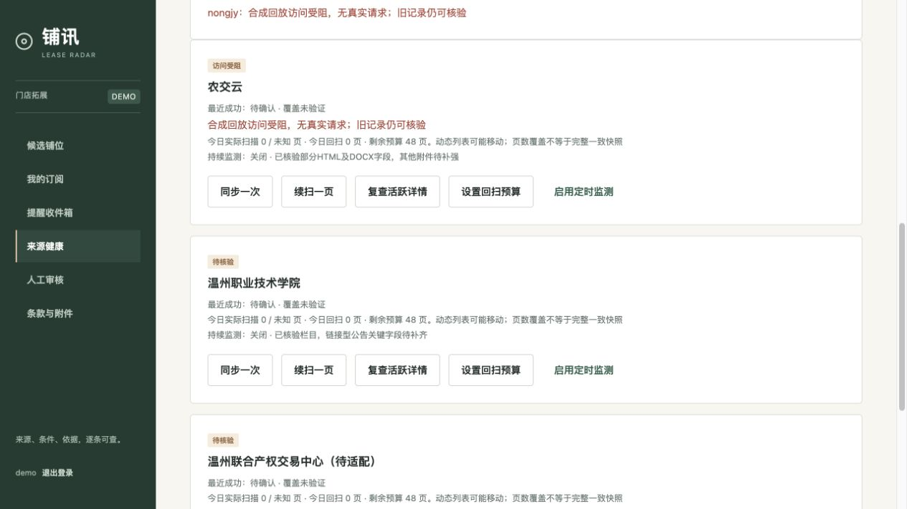
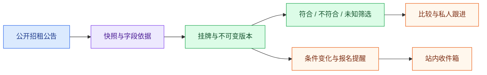
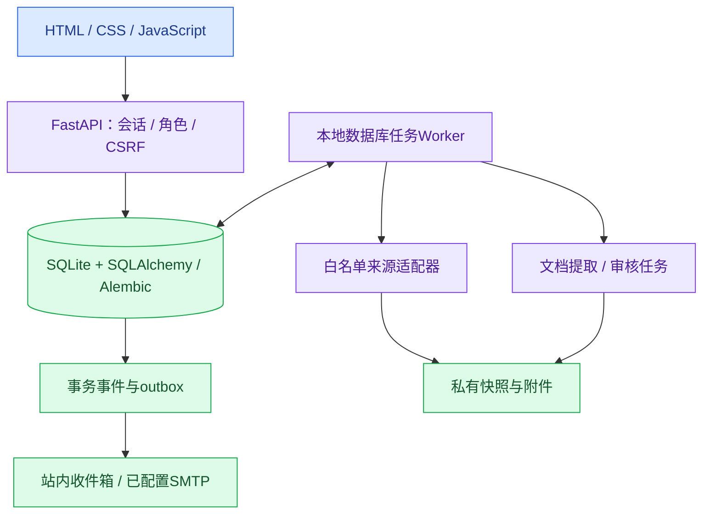

# LeaseRadar · 铺讯

**把招租公告发现、字段依据核验与门店拓展跟进，放进同一个工作空间。**

[English](README.md) · **简体中文**

[](https://github.com/17-chen/LeaseRadar/actions/workflows/test.yml)


[](LICENSE)

[快速开始](#快速开始) · [核心功能](#核心功能) · [界面预览](#界面预览) · [系统架构](#系统架构) · [项目状态](#项目状态) · [文档与贡献](#文档与贡献)

公开招租公告分散在不同站点，价格周期、报名期限和经营条件往往藏在正文或附件。铺讯面向门店拓展的信息整理场景，把公告发现、自由筛选、同口径比较、字段依据、变化提醒和私人跟进串成可回查流程。

**未知的价格周期继续保留未知，每个换算结果都需要依据。** 标题出现“五年租赁权”，不代表金额就是五年总租金；公告用途原文也不等于已经取得经营许可。

> [!NOTE]
> 当前为 `0.1.16` 本地开发版本，应用界面主要为中文，项目首页提供中英双语。生产部署、完整第二来源字段覆盖、真实PDF/OCR准确率及外部邮件投递仍待验收。合成DEMO使用独立示例数据，关闭外部采集、邮件和下载。

## 核心功能

| 能力 | 已有实现 |
| --- | --- |
| 公告监测 | 独立来源适配器、分页回扫、详情复查、不可变版本、私有快照，保留受阻/重试状态 |
| 自由筛选 | 关键词、地区、面积、已核实月租、物业/用途条件与报名状态；明确符合、不符合和未知三值匹配 |
| 同口径比较 | 2–5条候选按价格性质分组；原始金额、计算依据、保证金与未知周期分别展示 |
| 字段依据 | 回查原文和附件；区分真实来源变化、重新提取、人工纠正及字段冲突 |
| 个人工作台 | 收藏、跟进阶段、私人笔记、账号隔离，以及当前已应用条件的跨页结果导出 |
| 提醒与通知 | 站内变化与报名截止提醒；配置式SMTP、每日摘要、独立回执和结果不明审核 |
| 文档审核 | 受控PDF/DOCX下载、历史有界补扫入队、私有提取/审核任务；DOCX正文/表行定位及PDF/OCR结果校验 |
| 持久运行 | 数据库任务、租约恢复、事务事件/outbox、来源覆盖预算及备份工具 |

以上表示已有代码能力，真实来源验证与生产限制见下方[项目状态](#项目状态)。

## 界面预览

以下为实际应用的**合成DEMO截图**：两条候选有核实后的月租基准，另一条计价周期未知，继续显示待确认。当前界面主要为中文。



<details>
<summary>更多演示画面：筛选、字段依据与来源健康</summary>

### 自由选择筛选条件



### 回查字段判断依据



### 保留来源受阻状态



</details>

仓库保留[207.6秒有声浏览器演示稿](output/video/LeaseRadar_Full_Browser_Review_20261028.mp4)和[六页介绍PDF](output/pdf/LeaseRadar_Competition_Intro_Draft.pdf)。录制使用合成数据、自动化浏览器操作和系统配音，属于审阅稿，不代表真实用户试用。字幕、重建方式及分日期核验见[材料入口](docs/submission/README.md)。

## 从公告到跟进



金额使用`Decimal`，明确时刻带时区；报名截止优先于竞价截止。事件与outbox同事务提交，以唯一身份保持幂等；外部邮件回执单独记录，不承诺外部投递绝对一次。

## 系统架构



已核验的本地路径使用SQLite和数据库持久队列。仓库另提供PostgreSQL、Redis、Celery及隔离提取worker部署配置，生产运行仍待验收。提取结果须通过校验和人工审核才能改变业务字段。当前采用确定性提取与规则，无LLM依赖。

## 快速开始

### 1. 体验隔离合成DEMO

需要 **Git、Python 3.12或3.13**。macOS/Linux从全新克隆目录运行：

```bash
git clone https://github.com/17-chen/LeaseRadar.git
cd LeaseRadar
python3 -m venv .venv
.venv/bin/pip install -r backend/requirements.lock
.venv/bin/python scripts/demo.py --port 8002
```

打开`http://127.0.0.1:8002/`。终端会显示新生成的私有`DEMO_GUIDE.md`路径，里面包含本地账号和演示步骤。每次运行创建独立的`private/demo-runs/`子目录，保留已有数据库。Windows对应使用`.venv\Scripts\python.exe`和`.venv\Scripts\pip.exe`执行相关命令。

登录后点击**开始演示**：筛选 → 比较 → 已知金额依据 → 周期未知 → 收件箱 → 跟进 → 来源受阻。场景含 **6候选、7版本、5条站内消息**；另可查看个人收藏和当前筛选CSV导出。

按`Ctrl-C`停止。端口占用时选择其他空闲端口；旧DEMO报名时间过期后重新创建，不修改旧数据或把历史演示当成当前房源。

### 2. 运行个人本地工作空间

安装依赖后，从项目根目录迁移并创建本地管理员：

```bash
PYTHONPATH=backend .venv/bin/python -m app.cli migrate
PYTHONPATH=backend .venv/bin/python -m app.cli create-admin
PYTHONPATH=backend .venv/bin/uvicorn app.main:app --host 127.0.0.1 --port 8000
```

在另一个终端从项目根目录启动后台：

```bash
PYTHONPATH=backend .venv/bin/python -m app.local_worker
```

打开`http://127.0.0.1:8000/`，来源默认关闭。监测依赖Worker和主机持续运行，退出终端、休眠或关机会中断处理。私有运行配置、授权邮件目标、附件worker、备份与部署方式见[部署手册](docs/DEPLOYMENT.md)和[配置清单](docs/FINAL_SETUP_CHECKLIST.md)。

### 3. 查看已有录制

```bash
python3 scripts/serve_video_review.py --port 8017
```

打开`http://127.0.0.1:8017/`，可播放有声稿、查看中文字幕并点击十个场景定位。预览服务仅监听回环地址，支持分段请求以便跳转。字幕文字与旁白稿一致，句内时码为估算，完整真人听审尚未签收；见[字幕审阅记录](docs/submission/CAPTION_REVIEW_20261029.md)。

## 项目状态

证据快照：**2026-11-01**。测试数是工程检查记录，不代表字段准确率或业务效果。

| 范围 | 已有证据与剩余工作 |
| --- | --- |
| 自动检查 | [`5e19d0b`对应CI](https://github.com/17-chen/LeaseRadar/actions/runs/41220130408)通过327项应用测试及1项Poppler集成，另含迁移和前端JS语法检查。这是已有记录，不是本次README修改重新跑出的测试数。 |
| 真实来源 | 历史核验农交云24条挂牌、高校1条链接型记录，6份DOCX价格周期依据。高校适配器另有历史全文样本，但完整第二来源字段覆盖尚未完成；见[来源审计](docs/SOURCE_AUDIT.md)。 |
| 恢复与演示 | 隔离合成流程、账号/会话边界、SQLite升级/备份恢复和确切审阅ZIP恢复均有分日期记录，见[交接](PROJECT_HANDOFF.md)和[材料入口](docs/submission/README.md)。 |
| 文档与邮件 | DOCX及受控提取链路已有实现和本地检查；真实PDF/OCR准确率、容器隔离验收及服务商真实投递仍待验证。 |
| 生产运行 | 已有Docker部署配置；公网应用、生产并发、PostgreSQL恢复、来源长期覆盖和真实用户试用仍未验收。 |

仓库已公开。项目记录尚未核实公网应用地址、用户自行分享的视频链接或正式比赛提交回执；旧材料按原日期保留，可能写有当时的私有仓库状态。

## 开发与检查

安装锁定依赖后，从项目根目录执行：

```bash
PYTHONPATH=backend .venv/bin/python -m pytest -q backend/tests
node --check frontend/app.js
node --check output/video/review.js
.venv/bin/python scripts/build_browser_captions.py --check
.venv/bin/python -m pip check
git diff --check
```

`pdftotext`和`pdfinfo`在`PATH`中时，可另跑真实工具集成：

```bash
PYTHONPATH=backend .venv/bin/python -m pytest -q backend/integration/test_document_tools.py
```

测试使用隔离数据库及合成/本机通知端点。媒体重建另需可选工具，当前有声视频构建依赖macOS语音工具及Swift/AVFoundation。修改领域规则或来源适配器前请阅读[贡献说明](CONTRIBUTING.md)。

## 目录结构

| 路径 | 用途 |
| --- | --- |
| [`frontend/`](frontend/) | 中文工作台、依据面板、比较与账号交互 |
| [`backend/app/`](backend/app/) | API、领域规则、来源适配器、任务、通知和文档审核 |
| [`backend/migrations/`](backend/migrations/) | Alembic数据库迁移 |
| [`backend/tests/`](backend/tests/) · [`backend/integration/`](backend/integration/) | 隔离回归与真实工具集成检查 |
| [`fixtures/`](fixtures/) | 合成回放、来源适配器及评测样本 |
| [`scripts/`](scripts/) | 新建演示、媒体审阅与归档验证工具 |
| [`docs/`](docs/) · [`output/`](output/) | 架构、分日期证据、合成截图与审阅材料 |
| `private/` | 本地账号、数据库、快照、附件和备份，不入Git |

## 文档与贡献

- [English overview](README.md)
- [架构说明](ARCHITECTURE.md) · [部署手册](docs/DEPLOYMENT.md) · [历史附件补扫](docs/ATTACHMENT_BACKFILL.md)
- [演示路线](docs/COMPETITION_DEMO.md) · [介绍与视频材料](docs/submission/README.md)
- [路线图](ROADMAP.md) · [任务清单](TODO.md) · [更新记录](CHANGELOG.md)
- [项目上下文](PROJECT_CONTEXT.md) · [详细交接](PROJECT_HANDOFF.md)
- [贡献说明](CONTRIBUTING.md) · [行为准则](CODE_OF_CONDUCT.md) · [安全说明](SECURITY.md)
- [整理前README与阶段记录](docs/archive/README.before-bilingual.zh-CN.md)

欢迎用中文或英文反馈问题、改进文档。请附复现步骤，明确数据是合成、回放还是真实来源；分享日志或截图前移除凭据、原始私人文档与个人笔记。

## 许可证

项目原创代码采用[MIT许可证](LICENSE)。来源公告、附件、商标和原始交接材料有各自权利，见[数据政策](docs/DATA_POLICY.md)及[依赖许可证线索](docs/DEPENDENCY_LICENSES.md)。
